# CDAW plugins

Eleven open-source audio plugins with displays that show what the sound is doing: nine effects and two
synths. They started in [CDAW](https://github.com/CycyXX/cdaw), a free DAW, and work in any host that
loads VST3 (or Audio Units, on macOS).

| Effects | |
|---|---|
| **C-Comp** | Compressor: soft knee, sidechain, the transfer curve with a live dot, a scrolling level history |
| **C-Multicomp** | 4-band compressor: phase-aligned crossovers you drag on a live spectrum |
| **C-Esser** | De-esser: split or wideband, automatic threshold, listen to the band or to what it takes away |
| **C-Verb** | Reverb in eight types (Hall, Room, Plate, Shimmer, Reverse, Bloom, Gated, Cloud), 26 presets: separate decay for lows, mids and highs, ducking, freeze, cuts before and after, a map of how long each frequency rings |
| **C-Delay** | Stereo or ping-pong, free or in notes; drive and filters in the loop, tape wobble, ducking |
| **C-Chorus** | One to four voices, flanging, a view of the voices moving and the comb filter they make |
| **C-Phaser** | 2 to 12 stages, a sonogram of the sweep |
| **C-Filter** | Low, high, band pass or notch, an LFO and an envelope follower moving the cutoff |
| **C-Dist** | Distortion in six voicings after modern guitar amps, with a noise gate |

| Synths | |
|---|---|
| **C-Synth** | Wavetable synth for pads and atmospheres, 21 presets |
| **C-Lead** | Virtual analog synth for leads: hard sync, FM, a ladder filter, glide and vibrato, 22 presets |

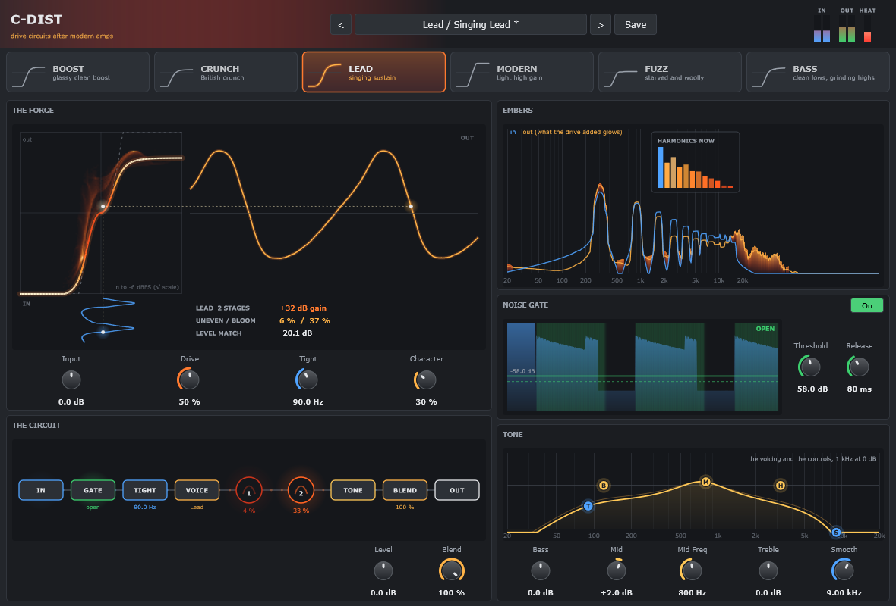

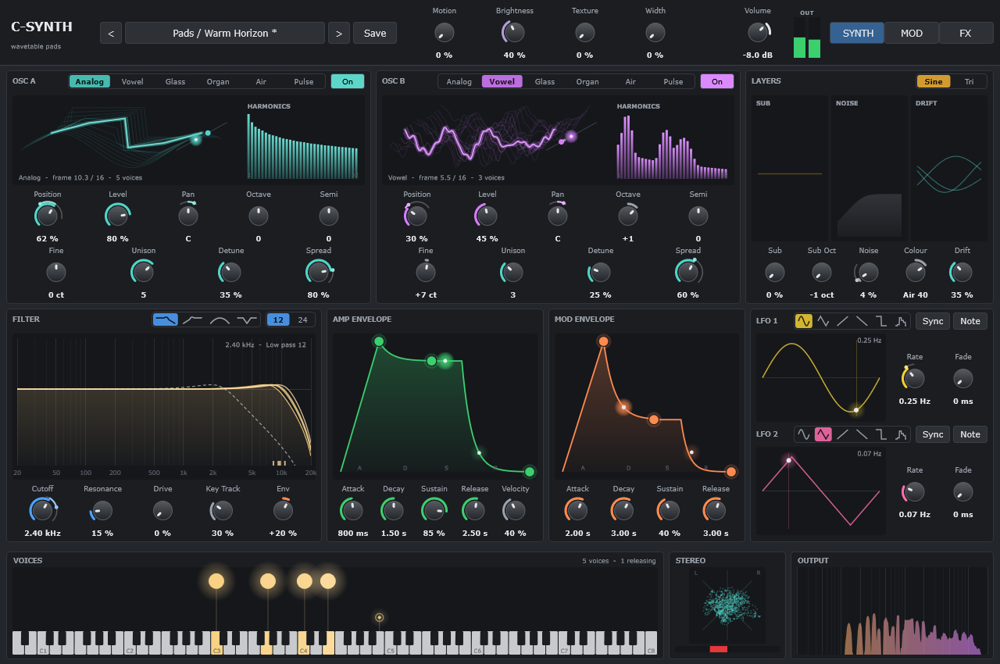

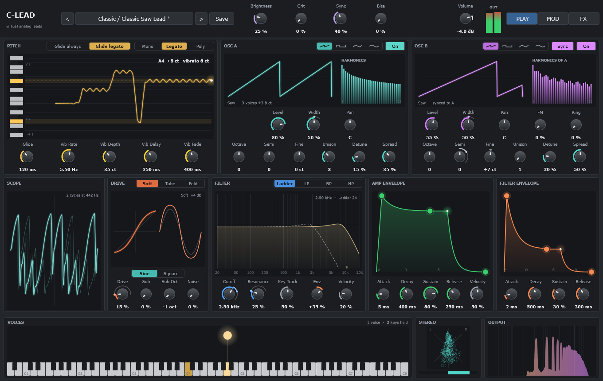

| | |
|---|---|
| 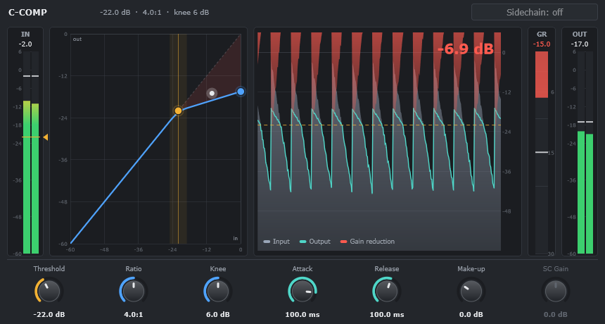 | 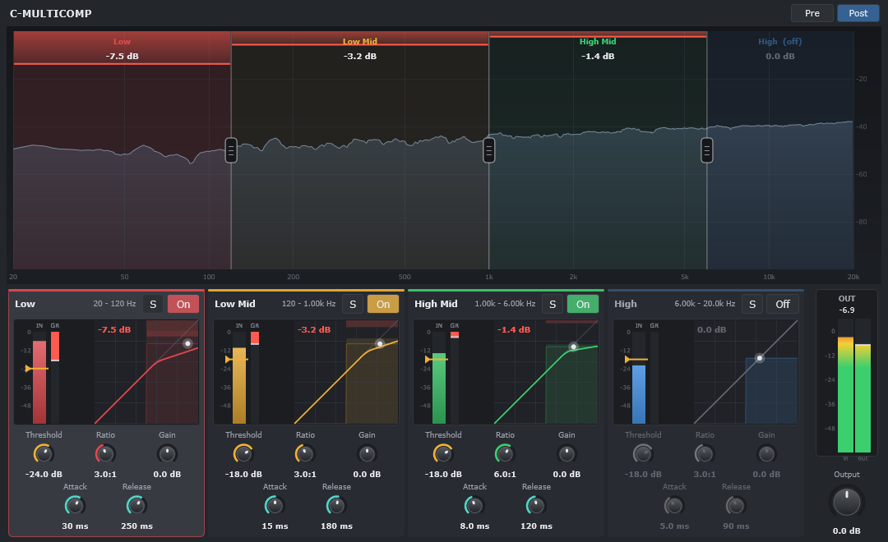 |
| 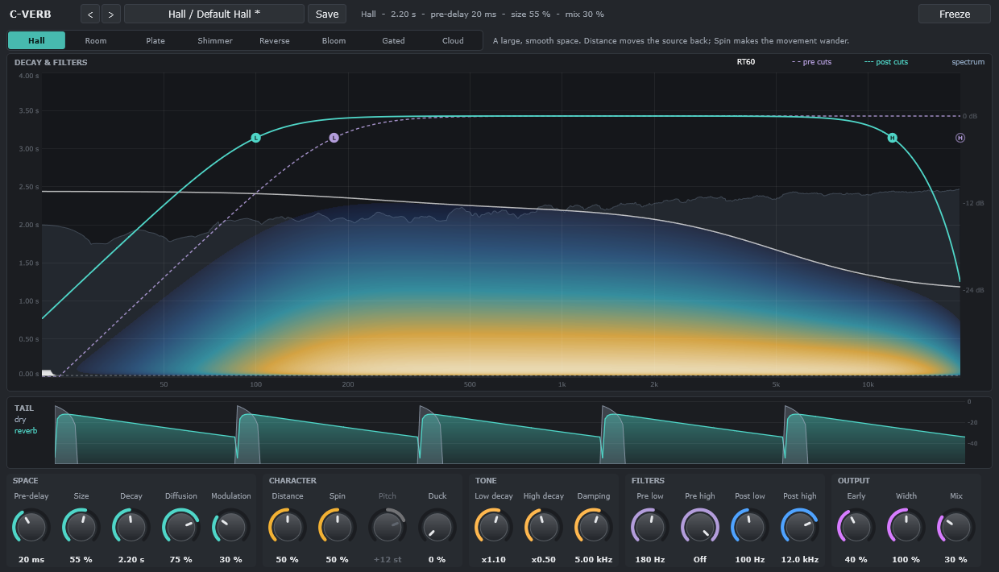 | 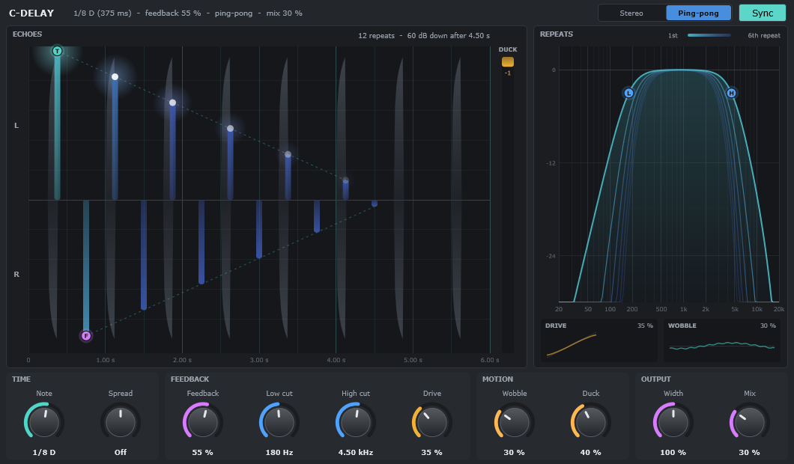 |
| 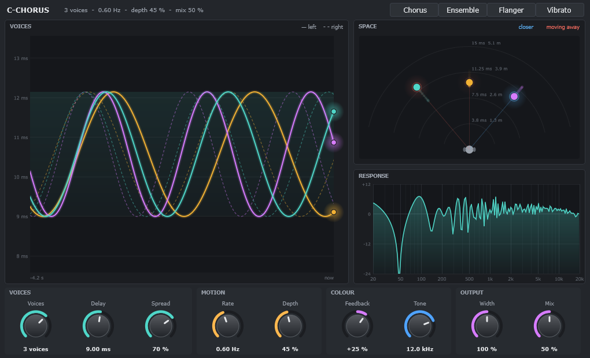 | 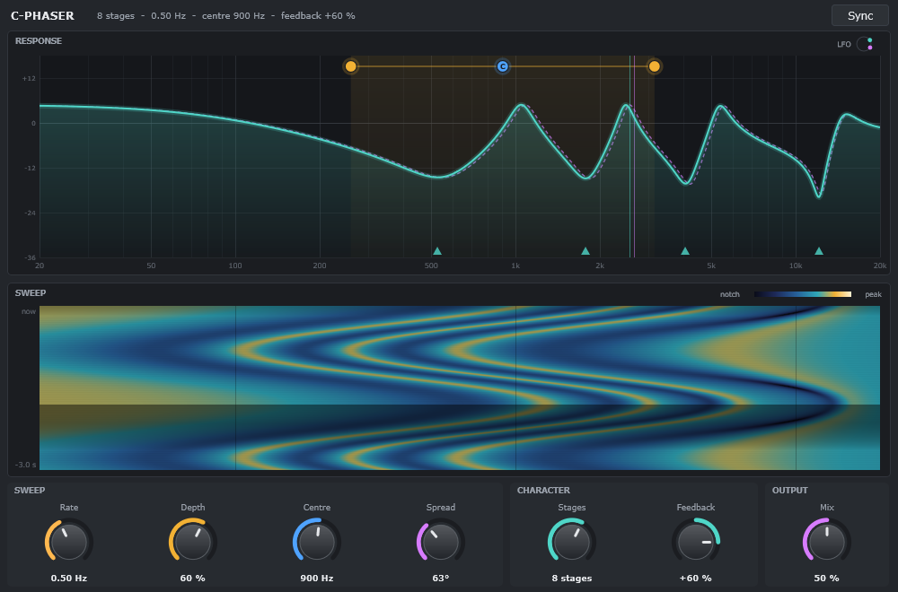 |
| 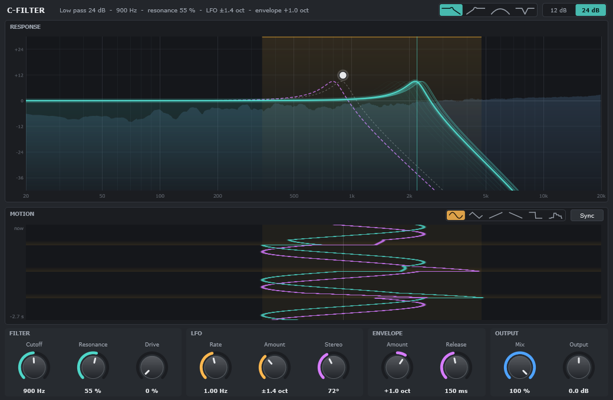 | 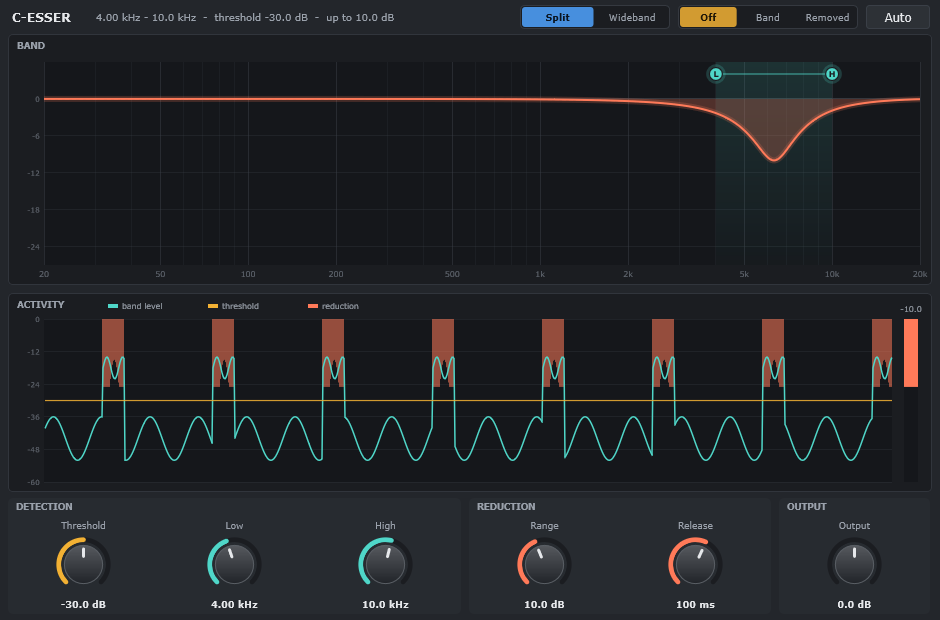 |

## Install

Download the zip for your system from [Releases](https://github.com/CycyXX/cdaw-plugins/releases) and
copy the plugins you want:

| System | VST3 | Audio Units |
|---|---|---|
| Windows | `C:\Program Files\Common Files\VST3` | |
| macOS | `~/Library/Audio/Plug-Ins/VST3` | `~/Library/Audio/Plug-Ins/Components` |
| Linux | `~/.vst3` | |

Then rescan plugins in your host.

**macOS:** the builds aren't signed yet, so macOS blocks them at first. After copying, run
`xattr -dr com.apple.quarantine <the plugin>`.

**Status by system:** the plugins are developed and listened to on Windows, in Cubase and in CDAW. The
macOS and Linux builds pass the same automated tests and [pluginval](https://github.com/Tracktion/pluginval),
but nobody has played them by ear yet. Reports are welcome.

Your own presets are kept in `CDAW/Presets/<plugin>` in your user settings folder (`%APPDATA%` on
Windows, `~/Library` on macOS, `~/.config` on Linux).

## Build

You need CMake 3.25 or newer, a C++20 compiler and git. JUCE comes as a submodule.

```
git clone --recurse-submodules --shallow-submodules https://github.com/CycyXX/cdaw-plugins.git
cd cdaw-plugins
```

On Windows, if the clone stops with "Filename too long", use a shorter folder or run
`git config --global core.longpaths true` and clone again.

| System | Configure and build | Plugins end up in |
|---|---|---|
| Windows (Visual Studio 2022 or newer, with C++) | `cmake --preset windows` then `cmake --build --preset windows` | `build/windows/VST3/*/*_artefacts/Release/VST3` |
| macOS (Xcode command line tools) | `cmake --preset macos` then `cmake --build --preset macos -j8` | `build/macos/VST3/*/*_artefacts/Release/{VST3,AU}` |
| Linux | `cmake --preset linux` then `cmake --build --preset linux -j8` | `build/linux/VST3/*/*_artefacts/Release/VST3` |

On Linux, first install JUCE's dependencies; [the CI workflow](.github/workflows/ci.yml) lists them.

Run the tests with the `cdaw_plugins_tests` program, in `build/<preset>/tests/cdaw_plugins_tests_artefacts/`.

On Windows, double-click `Install-Plugins.bat` (or run `.\scripts\install.ps1`): it builds every plugin from your checkout and installs the VST3s in
`C:\Program Files\Common Files\VST3\CDAW`. Close your hosts first, as they keep loaded plugins locked, then rescan
plugins in them. It warns you if what it installed isn't the latest `main`.

To change something, see [CONTRIBUTING](CONTRIBUTING.md).

## How the code is laid out

| Folder | What |
|---|---|
| `Shared/DSP` | The engines: all the sound, with no host and no UI |
| `Shared/<Plugin>` | A plugin's parameters, its view and its presets |
| `Shared/UI`, `Shared/LookAndFeel`, `Shared/Common` | Knobs, widgets, colours and the parameter list type, used by every plugin |
| `VST3/<Plugin>` | The small part that's specific to being a plugin: the processor and its build target |
| `VST3/Common` | What most plugins share of that |
| `tests` | Tests of the engines and views, with no host |

The plugins share code on purpose: C-Synth and C-Lead run C-Chorus's, C-Delay's and C-Verb's engines
as their effects, and C-Lead has C-Dist's. CDAW builds the same `Shared` code into its built-in effects,
using this repo as a submodule.

## License

Copyright (C) 2026 Cyrill Durrer and contributors.

Free software under the [GNU Affero General Public License](LICENSE), version 3 or (at your option) any
later version. There is no warranty. Third-party code keeps its own licence: see [THIRD_PARTY](THIRD_PARTY.md).

VST is a registered trademark of Steinberg Media Technologies GmbH. Other product names are trademarks of
their owners.
